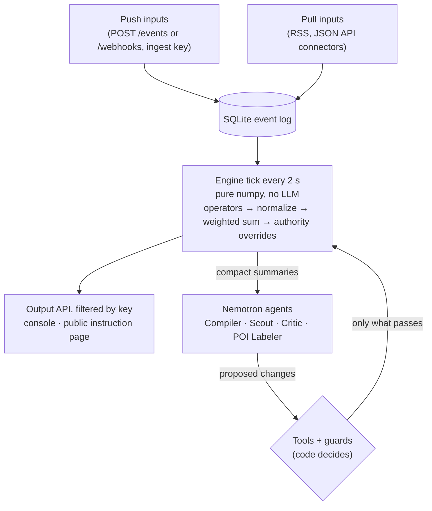

# FindingNemo

**Build your community's worst-day app in minutes.** Describe what you need in plain English, connect your sources, and get a live map that shows where help is needed most. Every AI change is checked by code before it ships.

FindingNemo is a platform for building live geo heat-map apps. A developer writes an app's intent and describes its inputs in plain words. NVIDIA Nemotron agents turn that into a proposed app, which the developer reviews, edits and confirms. Deterministic code then scores every incoming signal on a live grid, finds hotspots and places that need attention, and gives the public one safe instruction: where to go, and what to avoid.

Built for the **NVIDIA Nemotron** and **State Farm "Worst Day, at Scale"** tracks.

---

## Why

In a disaster, the signal exists, but nobody can trust it or act on it fast enough.

- In the 17 hours after Hurricane Harvey's landfall, Houston's 911 system took **more than 56,000 calls**, against about 8,000 on a normal day (Houston PIO Keith Smith, [via AP](https://insurancenewsnet.com/oarticle/the-latest-houstons-911-system-inundated-with-calls)).
- **41%** of 824 geocoded Harvey rescue requests on Twitter came from areas FEMA rated "minimal flood risk" ([Zou et al.](https://arxiv.org/abs/2111.07187)). The people in danger were where the static map said they were safe.
- Crowd signals can be faked: **99 phones** in a handcart created a fake Google Maps traffic jam in Berlin ([Simon Weckert](https://www.simonweckert.com/googlemapshacks.html)).

Every community's worst day is different. So FindingNemo is not one app. It is the platform that lets anyone build the one they need, from their own sources, and trust what it shows.

## Who uses it

| Role | What they do | What they see |
|---|---|---|
| **Developer** (authority key) | Describes the app and its sources, reviews and confirms the proposal, wires their own app or feeds to it, pins weights, reverts changes, accepts label proposals, asks the Scout for sources | Everything: all layers, hotspots, places (including sensitive ones), weights, verification scores, the agent trace and the change log |
| **End user** (public) | Opens a link on their phone and shares their own position | One instruction: a direction, a distance, a destination, an area to avoid. No map, no one else's location |
| **Platform** | Ingests, scores every 2 s, runs the agents, enforces every rule | n/a |

## The developer flow

| Step | Route | What happens |
|---|---|---|
| Home | `/` | **Start Project**, or reopen a past one (`/projects`) |
| About | `/new/about` | App name and intent, in plain English |
| Area | `/new/area` | Pick the area on a map (this sets the grid) |
| Sources | `/new/sources` | Describe each source in plain words. Nemotron suggests push or pull, the shape and ranked options (POST API, webhook, RSS, JSON API preset or custom URL). Set up connectors, map a webhook's JSON with the mapping editor, declare typed fields |
| Compile | `/new/review` | **Compile with Nemotron**, with live progress |
| Review and edit | `/apps/:id/review` | See the proposed tiers, operators, verification, labels and visibility; edit them; **Confirm & activate** |
| Keys | `/apps/:id/keys` | Ingest and authority keys, shown once, with ready-to-run curl and PowerShell examples |
| Console | `/apps/:id` | Live map with POI pins; tabs for Layers, Weights, Verification, Agents (label proposals, ask the Scout), Trace and Changes (with revert) |
| Public page | `/apps/:id/go` | The end-user instruction page |

## How it works



1. **Describe.** The developer writes the intent and each source in plain words: what a report means, who sends it, how much to trust it.
2. **Compile.** The **Compiler** turns that into a proposed spec: which operator handles each input, its tier (locked, stiff or flexible), spoof-check bounds, verification methods, which places are worth naming and which are sensitive. The developer's own inputs, intent, area, connectors and destinations are copied verbatim. Nothing is active until the developer confirms.
3. **Score.** Every 2 seconds, deterministic **operators** turn each input into a grid layer (the live catalogue is at `GET /v1/operators`):

   | Operator | Turns | Into |
   |---|---|---|
   | `flow_source` | movement tracks | where entities move away from (or toward), with a point estimate and its uncertainty |
   | `density` | point events | where reports cluster, decaying over time |
   | `dwell` | movement tracks | where entities stopped and stayed |
   | `field` | gridded or station data | a value field, optionally carried along a vector field the spec names |
   | `event_points` | geocoded documents | report locations weighted by confidence and source reliability |
   | `override` | authority fixed points | a confirmed zone that always wins |

   Layers are normalized and combined into one score map. Authority overrides are applied last and always win.
4. **Find sources.** The **Scout** searches the web, probes feeds, and configures and tests connectors. It runs when the Compiler or the developer asks for it (console Agents tab). Connectors then keep polling on their own.
5. **Improve, under a gate.** The **Critic** proposes new layer weights or lower trust for suspicious users. A weight change ships only if it improves a **held-out** backtest (70/30 split by time) on the verification methods the developer confirmed. Otherwise nothing changes, and the trace says why.
6. **Name places.** The **POI Labeler** names code-generated candidates using the app's label set and evidence such as OpenStreetMap features. It can never invent a coordinate. It may propose a new label type, which the developer accepts or dismisses.
7. **Guide people.** A member of the public posts their own position and gets one route-based instruction toward the safest reachable destination, checked by a message guard before it is sent.

## Nemotron proposes, code decides

Agents never write state directly. Every change goes through a validated tool and a guard, and is recorded with before and after values so the developer can revert it.

| Agent | Model (default) | Can propose | Must pass |
|---|---|---|---|
| Source suggester | Nemotron 3.5 Lightning | push or pull, shape and ranked options for a described source | structured output with one repair retry; options come from the catalogue only |
| Compiler | Nemotron 3.5 Super VL, reasoning on | the whole app spec | `validate_spec`, the developer's inputs pinned, developer confirmation |
| Scout | Nemotron 3.5 Super VL (planning), Lightning (per-article extraction) | new connectors, source reliability | URL safety guard and a connector test; extracted places outside the area are dropped |
| Critic | Nemotron 3.5 Super VL, reasoning on | weight and trust changes | held-out backtest, tier bounds, pins, cold-start check |
| POI Labeler | Nemotron 3.5 Lightning, low effort | names for code-found places, new label types | candidates only, label set only, sensitive labels stay private |

Rules enforced in code, not prompts:

| Rule | What it means |
|---|---|
| No LLM in the hot path | The 2-second tick is pure numpy. A rate-limited agent skips its run and logs why; the map keeps updating. |
| Locked stays locked | After confirmation, no agent can change a tier, a verification method or a locked weight. Stiff weights move at most ±10% per hour; flexible ones at most ±25% per step, with their total held. |
| Trust goes up only through a backtest | Agents may lower a user's trust with a reason. Raising it needs a passing backtest and is capped at +0.1 per user per 5 minutes. |
| Cold start | Flexible weight changes are rejected until at least two verification methods have data, with the reason in the trace. |
| Spoof detection | Duplicate coordinates across accounts, bursts of new IDs, shared devices, and (where the spec says so) impossible speeds or unnaturally steady, straight tracks are flagged. Being close together is never a flag. |
| Private by default | Raw inputs, the trace, sensitive places and other users' locations never reach a request without the authority key. The public instruction endpoint takes a position, not a user ID. |
| Connectors are config, not code | No LLM-generated code ever runs. Webhook mappings are dotted paths, not scripts. |
| Traced and reversible | Every agent step writes a trace entry; every state change writes a Change the developer can revert. |
| Domain-neutral | Nothing in `backend/` knows whether the entities are people, animals, vehicles or sensors. Domain knowledge enters only through the spec the developer confirms. |

"Mixture of experts" here is system-level: the operators are the experts, and Nemotron is the gate deciding how much each one counts, within locked rules. It does not refer to Nemotron's internal MoE routing.

## Quick start

Requirements: Python 3.11, Node 20 (what CI uses), and an API key from [build.nvidia.com](https://build.nvidia.com).

```bash
# backend
cd backend
python -m venv .venv && source .venv/bin/activate      # Windows: .venv\Scripts\activate
pip install -r requirements.txt
cp .env.example .env                                   # then fill in the keys below
uvicorn app.main:app --reload --port 8000

# frontend (second terminal)
cd frontend
npm install
npm run dev                                            # http://localhost:5173, proxies /v1 (and WebSocket) to :8000
```

Open http://localhost:5173 and click **Start Project**. The keys are shown once, after you confirm; the console uses the authority key.

The deterministic core (map, hotspots, overrides, spoof flags, routing) never calls a model. The agents need `NVIDIA_API_KEY`.

Key settings in `backend/.env`:

| Variable | Purpose |
|---|---|
| `NVIDIA_API_KEY` | Nemotron on build.nvidia.com (all agents) |
| `TAVILY_API_KEY` | web search for the Scout |
| `NOMINATIM_USER_AGENT` | required by Nominatim's usage policy for geocoding (a generic app name plus a contact) |
| `*_MODEL` | per-agent model as `<provider>::<model-id>` (defaults in `.env.example`) |
| `NVIDIA_RPM` | shared request budget per minute (default 35) |
| `SQLITE_PATH` | database file (default `./data/app.db`) |
| `DEMO_MODE` | `1` enables `/v1/debug/*` for simulator ground truth |

Never commit `.env`.

## Sending data

**Events**, in the platform's own shape. Fields are validated against the input's declared fields, and positions outside the app's area are rejected:

```bash
curl -X POST http://localhost:8000/v1/apps/<app>/inputs/<input>/events \
  -H "X-Ingest-Key: <ingest key>" \
  -H "Content-Type: application/json" \
  -d '{"user_id": "u1", "lat": 32.78, "lon": -96.76, "ts": "2026-11-08T12:00:00Z"}'
```

**Webhooks**, in another service's own JSON. The input's webhook mapping (set in the Builder) reads each item with dotted paths such as `pos.lat` or `geometry.coordinates.1`, then validates it exactly like `/events`. With a mapping of `items_path: "items"`, `lat: "pos.lat"`, `lon: "pos.lon"`, `ts: "time"`:

```bash
curl -X POST http://localhost:8000/v1/apps/<app>/webhooks/<input> \
  -H "X-Ingest-Key: <ingest key>" \
  -H "Content-Type: application/json" \
  -d '{"items": [{"pos": {"lat": 32.78, "lon": -96.76}, "time": "2026-11-08T12:00:00Z"}]}'
```

For senders that cannot set headers, `?key=<ingest key>` also works (it may end up in the sender's logs). The response gives counts of received and accepted items and the first 20 rejection reasons; the raw body is never stored.

The keys page shows these examples filled in for your app, in curl and PowerShell. `sim/` holds data simulators that stand in for a developer's app and its users; they post only through this public API.

## API

| Endpoint | Access |
|---|---|
| `GET /v1/operators` | public; the operator catalogue |
| `POST /v1/apps`, `GET /v1/apps/{app}` | create and read an app |
| `POST /v1/apps/{app}/sources/suggest` | Nemotron suggests how a described source connects |
| `POST /v1/apps/{app}/compile` | returns a proposed spec at `pending_confirmation` (`409` if active, `422` if it never finalizes, `503` on rate budget) |
| `GET /v1/apps/{app}/compile/status` | public progress, no trace text |
| `PUT /v1/apps/{app}/spec` | edit a pending spec |
| `POST /v1/apps/{app}/activate` | the developer's confirmation; returns the keys once |
| `POST /v1/apps/{app}/inputs/{input}/events` | ingest key |
| `POST /v1/apps/{app}/webhooks/{input}` | ingest key; mapped by config |
| `GET /v1/apps/{app}/map?format=geojson` | public layers; all layers with the authority key |
| `GET /v1/apps/{app}/hotspots`, `/pois` | filtered per item by visibility |
| `GET /v1/apps/{app}/inputs/{input}/raw` | authority key |
| `GET /v1/apps/{app}/trace`, `/changes`, `/weights`, `/verification` | authority key |
| `POST /v1/apps/{app}/weights/{layer_id}/pin` | authority key |
| `POST /v1/apps/{app}/changes/{id}/revert` | authority key; goes through the same tools and guards |
| `GET /v1/apps/{app}/label-proposals`, `POST .../{id}/accept`, `.../{id}/dismiss` | authority key |
| `POST /v1/apps/{app}/scout` | authority key; queues a Scout run |
| `WS /v1/apps/{app}/stream` | public frames; a first frame `{type: "auth", key}` unlocks the authority view |
| `POST /v1/apps/{app}/instruction` | public; body is the caller's own `{lat, lon}` |

Without `X-Authority-Key`, responses contain only public items; a wrong key gets `401`. The full contracts are in `CLAUDE.md` (Core contracts) and `backend/app/core/models.py`.

## Tests and CI

```bash
cd backend && pytest -q && ruff check .   # no network, no live LLM calls, fixed seeds
python -m pytest sim/tests -q             # from the repo root
```

760+ tests. Agent tests replay recorded model responses through the real `openai` client types, so retries, rate limits and malformed output are exercised offline.

GitHub Actions (`.github/workflows/ci.yml`) runs on every pull request and every push to `main`: backend `ruff check` and `pytest`, the sim tests, and a frontend type check (`tsc -b`, informational for now).

## Repository layout

```
backend/app/
  core/        contracts (Pydantic), SQLite store, clock, key checks, config
  engine/      tick, grid, operators, combine, verification, layer cache, backtests, trust, tiers,
               routing, candidates
  agents/      Compiler, Scout, Critic, POI Labeler, source suggester, LLM router, tool-calling loop, prompts
  tools/       every tool an agent can call, plus guards and the message guard
  connectors/  RSS and JSON API polling, presets, URL guard (config, not code)
  api/         REST and WebSocket endpoints
backend/tests/ tests and recorded fixtures
frontend/src/  React + Vite + TypeScript + Leaflet: Home, Builder, review, keys, console, public page
sim/           data simulators (post only through the public ingest API)
specs/         test fixtures
tools/         team message board CLI, phone-width check for the public page
reference/     reference implementation, kept out of backend/
```

`CLAUDE.md` is the full build spec and decisions log. `AGENTS.md` describes how the team's coding agents coordinated through a GitHub-issue message board.

## Team

Built by [@ramgudur](https://github.com/ramgudur) (lead), [@AllenZheng-05](https://github.com/AllenZheng-05), [@kida-k](https://github.com/kida-k) and [@Navmi-Srithaj](https://github.com/Navmi-Srithaj).
